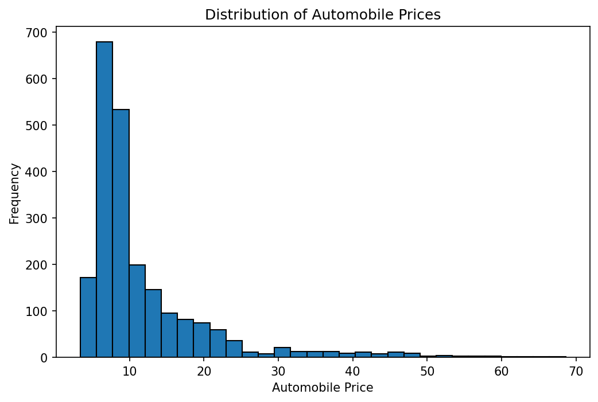
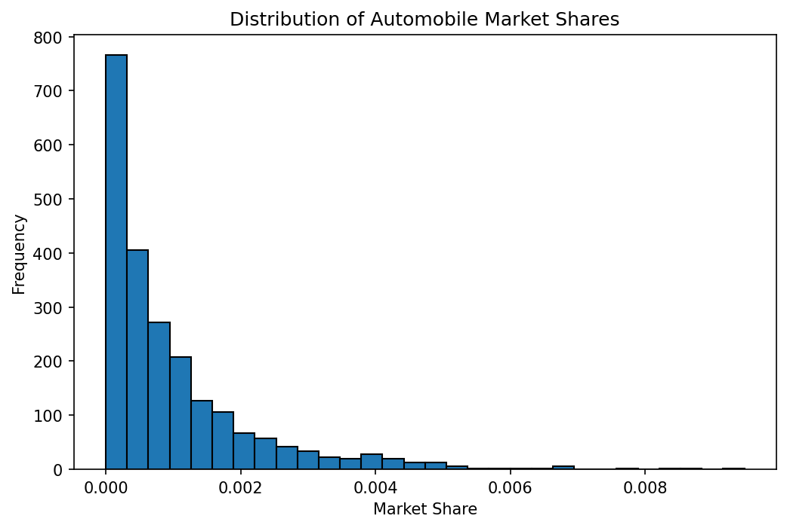
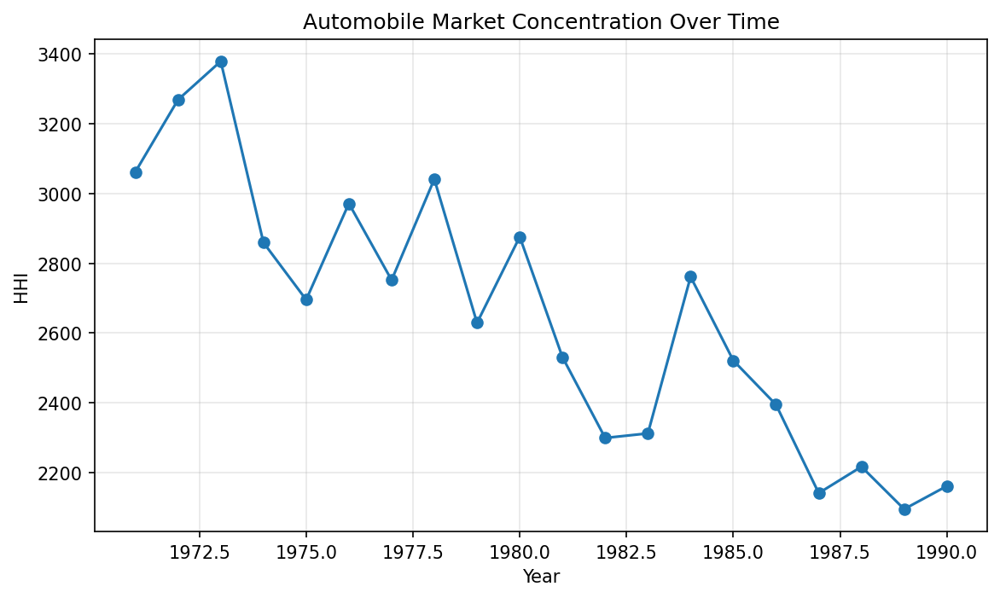
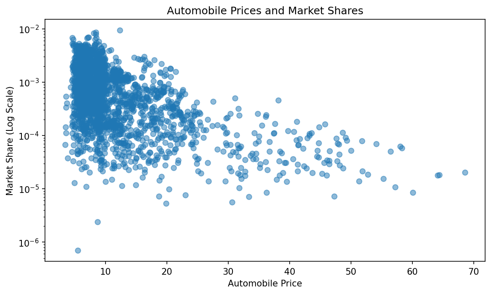
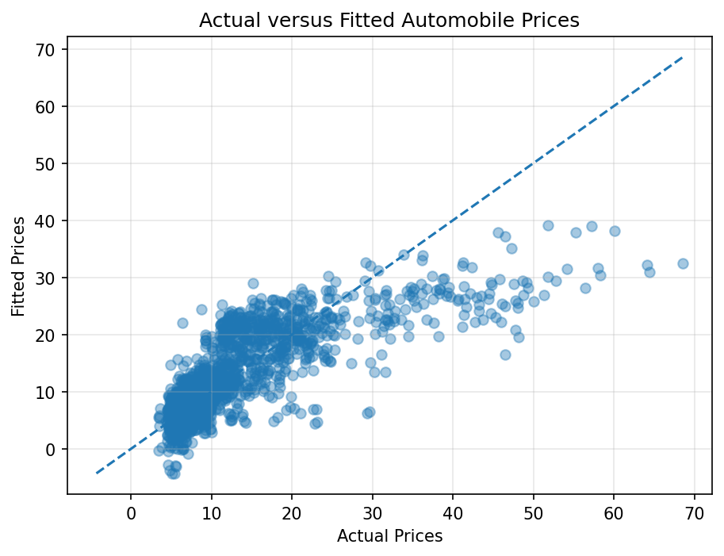
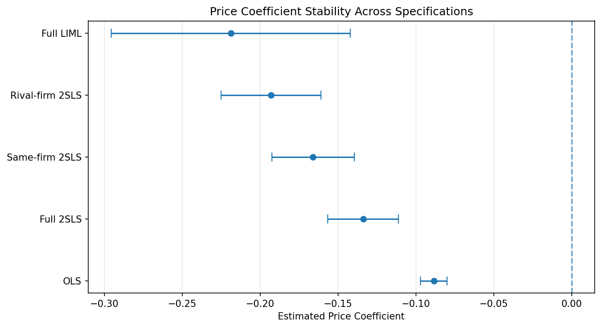

# When the Instruments Fail: Testing Price Endogeneity and Logit IV in the U.S. Auto Market

OLS, 2SLS and LIML estimates of automobile demand using the BLP data, 1971–1990

### What this project is about

This independent analysis was done to understand instrumental variables. The U.S. automobile industry is a differentiated product market where manufacturers compete through vehicles that differ in price and characteristics such as fuel efficiency, horsepower and size. Understanding how consumers respond to prices is important for studying competition, but prices also reflect hard-to-observe factors such as brand reputation and perceived quality. Because these factors affect both prices and demand, comparing prices with sales directly gives a misleading answer.

The project asks three questions about the U.S. automobile market from 1971 to 1990. First, how much does correcting for price endogeneity change the estimated price sensitivity? Second, are the standard BLP instruments strong and valid? Third, are the resulting demand estimates economically plausible?

The main finding is that the simple logit IV estimates are not credible. The instruments either fail the overidentification test or, when fixed effects remove that failure, become too weak to rely on.

### The data

The analysis uses the Berry, Levinsohn and Pakes (BLP) automobile dataset: 2,217 observations, where each year is a market (20 markets) and each observation is a vehicle in that market. It includes prices, market shares, product characteristics (horsepower-to-weight ratio, fuel efficiency, space) and eight ready-made instruments. The data is loaded through the `pyblp` package.

One variable is built for the analysis: the outside-good share, the share of consumers who buy none of the listed vehicles in a year. It equals one minus the sum of vehicle shares in that year, and it is used to build the log market-share ratio that is the outcome in the demand model.

#### Prices and market shares

Prices are strongly right-skewed: most vehicles are in the lower price range, with few expensive models. Market shares are also right-skewed: most models take a small share, and a few take much larger shares.




#### Market concentration over time

Concentration is measured each year with the Herfindahl-Hirschman Index (HHI), the sum of squared manufacturer shares.



#### Higher prices, lower market share

Higher-priced vehicles tend to have smaller market shares. The share axis is on a log scale because shares are so skewed.



### The problem: why prices are endogenous

Manufacturers set prices based on features we can see (horsepower, fuel efficiency, size) and features we cannot (brand appeal, reliability, perceived quality). The unseen features push both prices and demand up. A car with a strong reputation can charge more and still sell well, which makes expensive cars look less price-sensitive than they are. A regular regression (OLS) is therefore biased, and we need instruments.

An instrument is a variable that moves prices but affects demand only through prices. A good one meets two conditions. It must be relevant, meaning it is correlated with price, and it must be exogenous, meaning it is unrelated to the unobserved factors that affect demand.

### The Model

The demand model is a logit model:

> **log(*s<sub>jt</sub>*) − log(*s<sub>0t</sub>*) = α*p<sub>jt</sub>* + *X<sub>jt</sub>*′β + ξ<sub>jt</sub>**

Here *s<sub>jt</sub>* is the market share of vehicle *j* in year *t*, and *s<sub>0t</sub>* is the share of the outside good. The price is *p<sub>jt</sub>*, *X<sub>jt</sub>* holds the observed characteristics, and *ξ<sub>jt</sub>* is unobserved quality. The main number of interest is *α*, the price coefficient. A more negative *α* means consumers are more sensitive to price.

### The instruments

The BLP instruments are built from the characteristics of other vehicles in the same year. Four are sums over other vehicles made by the same manufacturer, and four are sums over vehicles made by rival manufacturers. The vehicle itself is never included.

| Instrument | What it measures |
|---|---|
| demand_instruments0 | Number of other same-firm vehicles |
| demand_instruments1 | Sum of same-firm horsepower-to-weight |
| demand_instruments2 | Sum of same-firm air conditioning |
| demand_instruments3 | Sum of same-firm miles per dollar |
| demand_instruments4 | Number of rival-firm vehicles |
| demand_instruments5 | Sum of rival-firm horsepower-to-weight |
| demand_instruments6 | Sum of rival-firm air conditioning |
| demand_instruments7 | Sum of rival-firm miles per dollar |

The instruments are jointly relevant: the first-stage F-statistic is 36.26 (p < 0.001), and they explain about 14.8% of the variation in prices after controlling for car characteristics. The first stage fits prices well in the lower and middle price range but under-predicts the most expensive cars.



### Results

| Specification | Price coefficient | 95% CI | Overid. test p-value | First-stage partial R² |
|---|---|---|---|---|
| OLS | −0.088 | [−0.097, −0.080] | n/a | n/a |
| 2SLS, 8 instruments | −0.134 | [−0.157, −0.111] | < 0.001 | 0.148 |
| 2SLS, same-firm instruments | −0.166 | [−0.193, −0.140] | < 0.001 | 0.111 |
| 2SLS, rival-firm instruments | −0.193 | [−0.225, −0.161] | < 0.001 | 0.091 |
| LIML, 8 instruments | −0.219 | [−0.296, −0.142] | n/a | 0.148 |
| 2SLS, firm fixed effects | −0.079 | [−0.109, −0.048] | < 0.001 | 0.121 |
| 2SLS, firm + year fixed effects | −0.422 | [−0.702, −0.141] | 0.152 | 0.004 |

The full table is in `outputs/results.csv`.



#### What the results show

Correcting for endogeneity matters. Every IV estimate is more negative than the OLS estimate of −0.088, which is consistent with unobserved quality pushing OLS toward zero.

The instruments are strong but not valid. The overidentification test rejects in every specification where the instruments are strong. Rejection means either that some instruments are invalid or that the simple logit is misspecified, and the test cannot say which. The estimates also disagree with each other, ranging from −0.13 to −0.22, whereas valid instruments would give similar answers.

Fixing validity destroys strength. With firm and year fixed effects the test stops rejecting (p = 0.152), but the first stage collapses (partial R² = 0.004), so the estimate of −0.42 is too imprecise to trust.

#### Are the estimates economically plausible?

If firms set prices to maximize profit, the logit model implies a markup, and so a marginal cost, for each vehicle. A negative marginal cost is impossible, so the share of vehicles with negative implied cost is a useful check.

| Specification | Vehicles with inelastic demand | Vehicles with negative implied marginal cost |
|---|---|---|
| OLS | 68% | 69% |
| 2SLS, 8 instruments | 35% | 37% |
| 2SLS, year fixed effects | 21% | 23% |
| 2SLS, firm fixed effects | 74% | 75% |
| 2SLS, firm + year fixed effects | 0% | 0% |

Price coefficients from −0.08 to −0.16 are too small to be consistent with profit-maximizing firms. Only the firm-and-year estimate avoids the problem, and it rests on very weak instruments.

### Conclusion

Price endogeneity matters in this market, and the choice of instruments and fixed effects drives the results. No specification gives instruments that are both strong and plausibly valid, so this analysis does not provide a reliable estimate of consumers' price sensitivity. The random-coefficients model of Berry, Levinsohn and Pakes, designed for this setting, is the natural next step.

### Limitations

The overidentification test cannot separate invalid instruments from a misspecified model. The logit also assumes that when one car's price rises, demand for every other car rises by the same percentage, however similar the cars are.

The data covers 1971 to 1990 only, from a single dataset and a limited set of specifications. The BLP instruments also assume that product characteristics are unrelated to demand shocks.

### Repository structure

```
notebooks/analysis.ipynb   full analysis, discussion and figures
figures/                   all charts from the notebook
src/                       data loading, variable construction, estimation
scripts/                   run in order to reproduce the results table
data/                      BLP data and the processed panel
outputs/results.csv        results for every specification
```

### How to run

```
pip install -r requirements.txt
python scripts/01_pull.py
python scripts/02_build.py
python scripts/03_estimate.py
```

The scripts reproduce the results table in `outputs/results.csv`. The notebook contains the full analysis, discussion and all figures.

### Reference

Berry, S., Levinsohn, J., and Pakes, A. (1995). Automobile Prices in Market Equilibrium. Econometrica, 63(4), 841–890.

### Next steps

I will consider the supply-side instruments and try to fully replicate the Berry, Levinsohn and Pakes (1995) paper.
